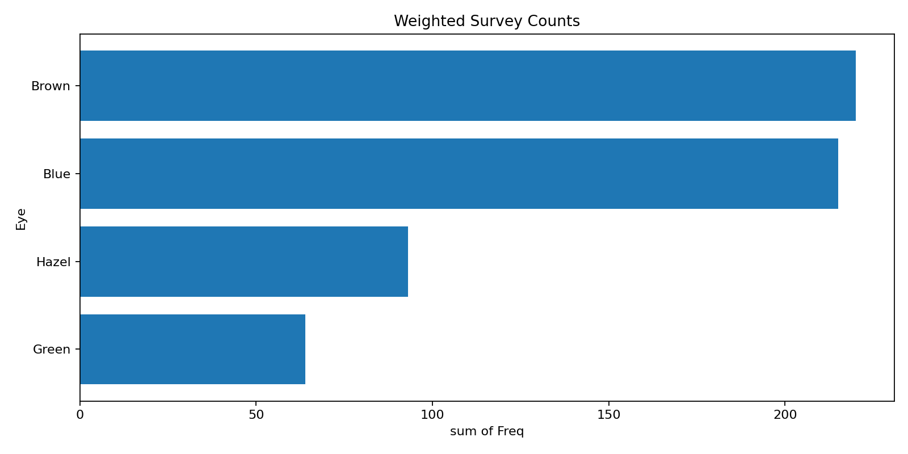

# Weighted Survey Counts — executed results

## Decision question
How are recorded respondents distributed by eye colour?

## Evidence
The largest observed sum of Freq is 220.000 for Brown. This ranking is descriptive, not a recommendation.

Raw rows: 32. Rows used: 32. Excluded for missing/nonfinite required values or invalid denominator: 0.

## Method
Sum recorded Freq within each Eye category; the row grain is an aggregated cell.

## Interpretation and limitations
Rows are contingency-table cells; use frequency weights, never row counts as respondent counts. No causal inference, significance claim or production deployment is implied. Missing values are not imputed; identical rows are retained. Small or repeated samples limit uncertainty interpretation.

## Recommended next decision
Retain weights when cross-tabulating hair colour and sex.

## Reproducibility
Source and exact downloaded-byte SHA256 are recorded in run_manifest.json. SQL results are in answer.csv and analysis.sqlite. Review quality_audit.csv before interpretation.
